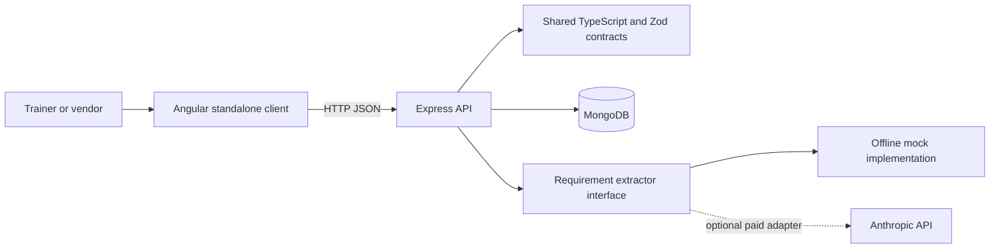

# Architecture

The project is a small npm-workspace monorepo. Angular owns the experience, Express owns authorization and data access, and `shared` owns request schemas used at trust boundaries.

The API must validate every request and enforce role and ownership checks. Client guards improve navigation but do not grant access. Refresh credentials use httpOnly cookies; contact reveals are audited. Posting terms belong to one vendor and are never exposed to competing vendors or trainers.