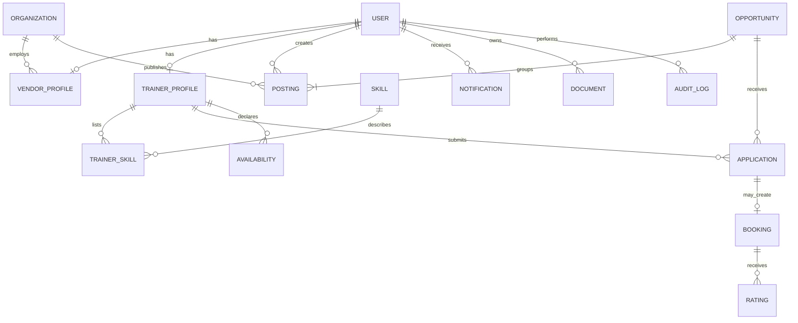

# Data model

One opportunity is the shared training need; each vendor or group contributes a separate posting with private rates and terms.

| Schema | Purpose |
| --- | --- |
| User | Login identity, role, and account lifecycle. |
| Organization | A vendor company, college, or corporate buyer. |
| VendorProfile | A user's recruiter/owner membership and verification state. |
| TrainerProfile | A trainer's public skills, rates, location, and verification state. |
| Skill | A normalized skill name with aliases and related skills. |
| TrainerSkill | A trainer's proficiency and evidence for one skill. |
| Opportunity | The deduplicated training need shared across postings. |
| Posting | A vendor/group source and its private rate and terms. |
| Application | A trainer's application and workflow state. |
| Booking | An accepted application and scheduled engagement. |
| Availability | A trainer's available or blocked time range. |
| Rating | Feedback recorded after a booking. |
| Notification | An in-app event for a user. |
| AuditLog | A minimal record of sensitive actions such as contact reveal. |
| Document | Metadata for a credential or uploaded proof; storage is externalized. |